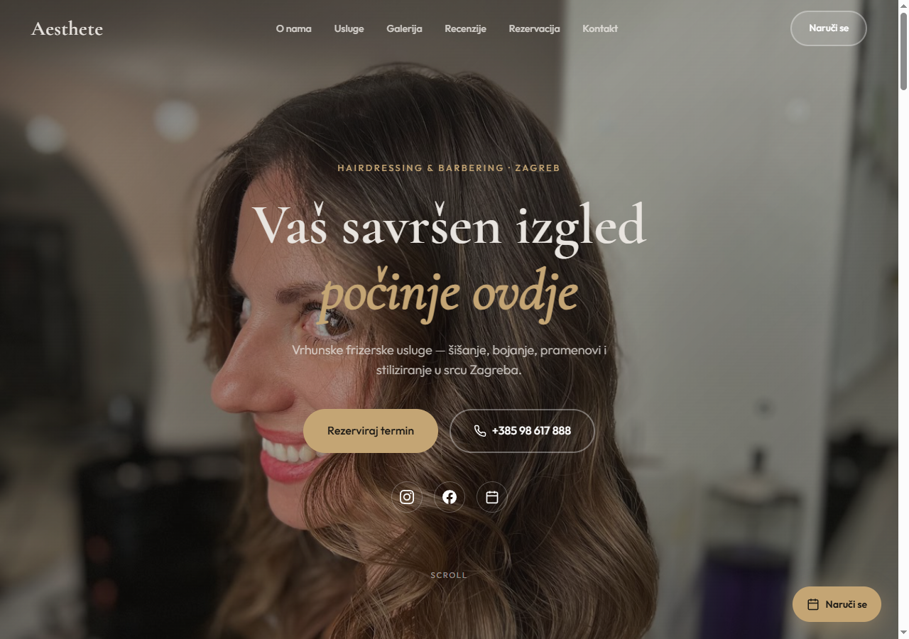
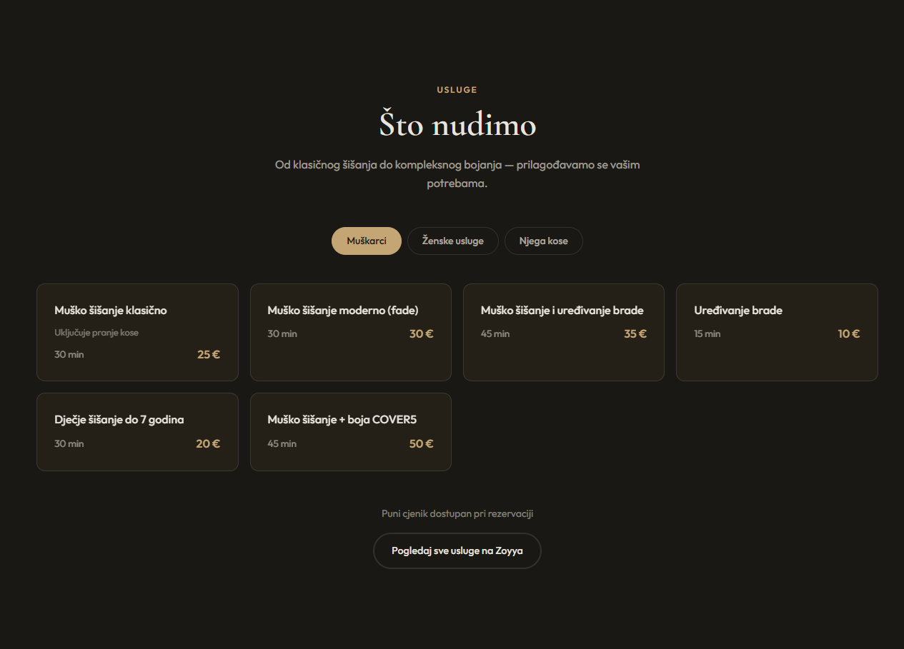
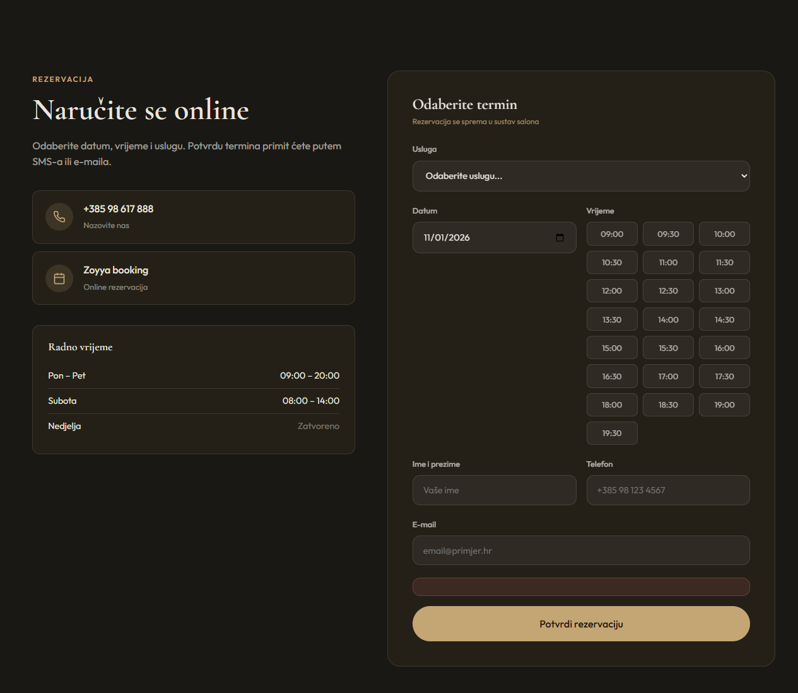

# Aesthete Hairdressing

Javna stranica salona **Aesthete Hairdressing** u Zagrebu i mali admin za termine. Stranica je statični HTML. Rezervacije idu u Supabase. Admin je zaštićen Supabase prijavom.

Živi primjer: [frizertaj.vercel.app](https://frizertaj.vercel.app)

## Što gost vidi

Naslovnica vodi na rezervaciju, poziv i društvene mreže.



Cjenik je po skupinama: muškarci, ženske usluge, njega kose. Kartica drži trajanje i cijenu.



Dalje na stranici su galerija, Google recenzije, forma za termin i kontakt (Šime Devčića 1, Zagreb).

## Kako radi rezervacija

Gost odabere uslugu, datum i slobodan termin, pa upiše ime, telefon i po želji e-mail.



1. Stranica učita javni Supabase URL i anon ključ s `/api/config`. Ta ruta čita env na Vercelu i ne vraća service role ključ.
2. Za odabrani datum učitaju se zauzeti termini. Otkaženi se ne računaju.
3. **Potvrdi rezervaciju** napravi `INSERT` u tablicu `bookings`. Anonimni posjetitelj smije samo to. Ne može čitati tuđe termine.
4. Isti datum i isto vrijeme ne mogu imati dvije aktivne rezervacije. Baza to drži unique indeksom.
5. Novi termin dobije status `pending`.

Radno vrijeme na formi: pon–pet 09:00–20:00, subota 08:00–14:00, nedjelja zatvoreno. Termini idu na pola sata.

## Admin

`/admin/` traži prijavu. Korisničko ime `admin` mapira se na `admin@aesthete.hr`. Ako upišeš e-mail s `@`, koristi se taj e-mail. Lozinku postavljaš sam u Supabaseu i ne ide u git.

Prijavljeni admin vidi pregled, listu rezervacija i može potvrditi, odbiti, označiti odrađeno ili obrisati termin. Statusi su `pending`, `confirmed`, `completed` i `cancelled`.

## Pokretanje

Treba Supabase projekt i, za produkciju, Vercel. Detalji su u [SETUP.md](SETUP.md).

```bash
npx vercel env pull .env.local
```

U `.env.local` trebaju `SUPABASE_URL`, `SUPABASE_ANON_KEY`, `SUPABASE_SERVICE_ROLE_KEY`, plus `ADMIN_EMAIL` i `ADMIN_PASSWORD` samo za prvo kreiranje admina. Service role ostaje na serveru.

Shema:

```bash
node scripts/setup-supabase.js
```

Skripta pokrene `supabase/schema.sql` i kreira admin korisnika iz env varijabli. Lokalno se stranica može otvoriti i bez baze. Forma tad ne može spremiti termin.

```bash
npx vercel dev
```

ili bilo koji statični server na rootu projekta. `index.html` vuče `css/` i `js/` relativno.

## Što je u repozitoriju

| Putanja | Uloga |
| --- | --- |
| `index.html` | Javna stranica |
| `css/style.css` | Izgled stranice |
| `js/main.js` | Navigacija, galerija, forma |
| `js/booking-shared.js` | Usluge, termini, upis u bazu |
| `js/supabase-config.js` | Spajanje na Supabase |
| `api/config.js` | Vercel funkcija, javni ključevi |
| `admin/` | Admin panel |
| `supabase/schema.sql` | Tablica `bookings` i RLS |
| `images/` | Fotografije salona |

`leads.json`, mapa `outreach/` i `.env.local` nisu dio repozitorija.
